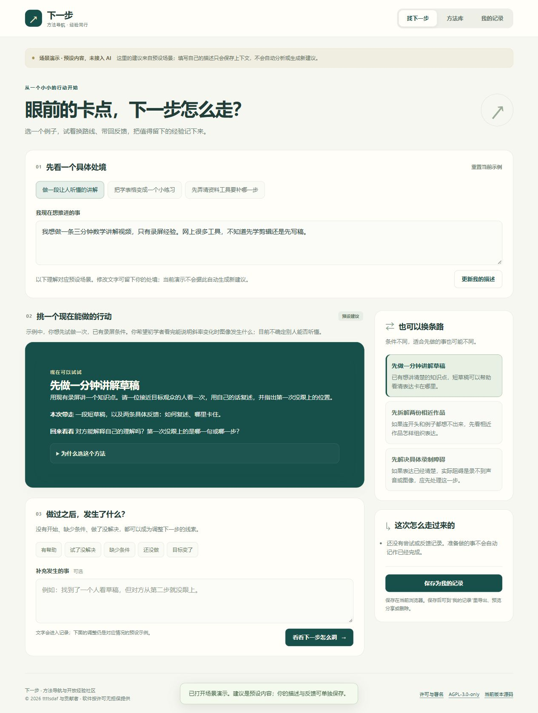

# 下一步 · 方法导航

想做件事，却不知道从哪里开始？把目标告诉「下一步」，它会帮你说清楚接下来做什么。需要别的 AI 动手时，你会拿到一段可以直接复制的话，也会知道该发给谁。

**[打开在线试用](https://librechat-pilot.up.railway.app)** · **[留下试用反馈](https://github.com/ttttsdaf/method-navigation/discussions/2)**

## 第二阶段 · 在线小范围试用

第一阶段做出了可以在本地运行的场景演示。现在可以在网站注册或登录，直接问自己遇到的问题。比如你可以问「我有三张扫描图，想按文件名顺序合成一个 PDF，能让 AI 帮我吗？」网站会帮你把任务写成一句话，你可以复制给平时用的、能处理这些文件的 AI 助手，让它用手头已有的工具做完。

如果要把社区图书角的借还登记、预约和到期提醒连起来，建议就会换一种写法：请能查资料的 AI 先找成熟工作流和开源项目，带回来源、推荐理由和验证办法。你也可以告诉网站「我只有手机」或「我已经试过这个办法」，让它按你的实际条件调整。

本轮全站共用 100 次模型请求，额度用完会暂停。在线咨询的问题会发给 DeepSeek，账号和对话保存在托管服务上，请用可以分享的材料试用。

## 怎么反馈

我们现在最想知道，**把网站给的那段话发出去以后，另一个 AI 能不能接手，最后做成了什么？** 可以回发链接的 QQ 群告诉项目发起人，也可以回复 [GitHub 反馈帖](https://github.com/ttttsdaf/method-navigation/discussions/2)。方便的话，照这一句写就行：

> 我想做___。网站建议我把「___」发给___。我试完得到___，卡在___。

如果第一步就看不懂，直接指出那句话也有帮助。文字或打码截图都可以。

## 第一阶段 · 仓库里的本地演示（v0.1.0）

下面的截图、运行方法和功能表对应仓库里的演示版。它用 **3 个合成场景** 展示如何选择路线、尝试、反馈和调整，填写的描述保存在本地，建议来自预设内容。



[项目想法](VISION.md) · [后续路线与开放问题](ROADMAP.md) · [方法来源](docs/SOURCES.md) · [参与方式](CONTRIBUTING.md)

首次公开：[项目介绍：为什么想做这件事](https://github.com/ttttsdaf/method-navigation/discussions/1) · [来聊聊你怎样找到“下一步”](https://github.com/ttttsdaf/method-navigation/discussions/2)。欢迎不同背景的读者参与，简短的具体经历或不同意见也有帮助。

第一次公开希望同时展示作品和分享思想，也听取不同背景的人的意见。想先理解构想，可以看截图和 [VISION](VISION.md)；想试一试，可以按下面的步骤运行；有亲身经验或不同意见，可以从 [参与方式](CONTRIBUTING.md) 选择一件小事，不需要先会编程。

## 先体验一条路线

例如，你想做一条数学讲解视频，搜到许多工具，却还不知道该先做什么。示例会给出不同起点：先做一分钟草稿、拆解相近作品，或解决具体录制障碍。

选择一条路线，再试试“缺少条件”或“试了没解决”。看看后续行动是否随情况变化，再把这段过程保存成记录。这里的目标是让人看清产品思路；场景里的行动与结果不是真实用户案例。

## 本地运行

需要 Python 3.10 或更新版本，以及支持 JavaScript、`dialog` 和 `localStorage` 的现代浏览器。无需安装 Python 包、Node 依赖或填写模型密钥。

下载项目文件并解压，进入含有 `serve.py` 的目录。

Windows：双击 `start-preview.cmd`；或在终端运行：

```powershell
py -3 serve.py
```

macOS / Linux：

```sh
python3 serve.py
```

打开 <http://127.0.0.1:8767/>。终端保持运行，按 Ctrl-C 停止。可加 `--open` 请求打开默认浏览器；端口被占用时可指定 `--port 8768`。没有 `py` 命令时，用已安装的 Python 3.10+ 解释器运行同一个文件。

页面通过 HTTP 读取 JSON，请通过预览服务访问。当前 `/data/` 路径由 `serve.py` 映射，不能把整个目录直接上传到 GitHub Pages 就当成可用网站；静态站打包尚待实现。

## 本地演示有哪些功能

| 功能 | 当前范围 |
| --- | --- |
| 场景与路线 | 讲解创作、表格学习、资料工具选择；共 9 条预设路线 |
| 反馈后调整 | 每条路线有 5 类反馈，共 45 条预设分支 |
| 方法浏览 | 6 张新编写的场景行动卡，可搜索、展开步骤和延伸阅读；数据中另有 1 条组合路线 |
| 个人记录 | 保存、恢复、删除描述、路线与反馈历史 |
| 带走经验 | JSON / Markdown 导出，可手动编辑的分享草稿预览 |

自由输入分析、实时检索、具体联系人匹配、自动执行、账号同步、公共投稿与社区审阅尚未实现。当前也没有证明推荐有效或能提升使用者的长期判断能力。

## 本地演示的数据怎样保存

记录保存在当前浏览器、当前来源的 `localStorage` 中。浏览器、隐私模式、地址或端口改变后，原记录可能不可见；清除网站数据可能删除记录。建议导出备份。当前可以恢复已保存的浏览器记录，尚不支持导入导出的 JSON。

本地运行没有账号、分析统计、远程字体或模型调用。查看方法来源时会打开外部网站。分享预览与下载不会上传内容，也不会自动脱敏，请自行检查要带走的文字。

## 文件结构

```text
app/                 HTML、CSS、JavaScript、预设场景
content/             方法内容与明确标注的虚构经验示例
docs/SOURCES.md       参照来源与改写边界
assets/              真实运行截图
serve.py             仅监听本机的预览服务
start-preview.cmd    Windows 启动入口
LICENSE              AGPL-3.0-only 完整文本
LICENSES/            CC BY-SA 4.0 完整文本
NOTICE.md            文件范围、署名与源码说明
VISION.md            产品愿景与价值假设
ROADMAP.md           下一阶段、借鉴方法与待定选择
CONTRIBUTING.md      如何描述问题和贡献经验
```

采用普通 HTML/CSS/JavaScript、独立 JSON 和 Python 标准库。这样可以先修改内容与交互，不依赖框架构建。文件格式仍在探索中，尚未承诺为稳定 API。

## 本地演示的验证范围

开发时已在 Windows 上检查保存、刷新恢复、删除、路线反馈、导出与分享编辑，并检查桌面及 390×844 窄屏布局。0.1.0 发布检查还覆盖独立目录运行、六张新行动卡、数据引用、许可文件、源码下载、文档链接与打包完整性。

上述检查针对 v0.1.0 的演示功能。macOS / Linux 的启动命令和浏览器存储配额耗尽的情况仍待实测。第二阶段的实际使用效果通过群友试用反馈继续检验。

## 许可与致谢

项目以帮助人为核心，具体原则见 [VISION](VISION.md)。软件代码按 **AGPL-3.0-only** 发布，列明的项目原创内容按 **CC BY-SA 4.0** 发布；范围、署名与完整条款见 [NOTICE](NOTICE.md)。用户自己输入的内容不自动归入项目许可。

六条旧来源改写稿没有进入本版。当前行动卡是围绕演示新编写的项目说明，保留前期研究入口；逐条处理决定见 [SOURCES](docs/SOURCES.md)。外部原文不由本项目重新授权，思想、事实与一般方法也不因这些说明而被本项目占有。

页脚可下载当前实例的源码 ZIP，包含运行所需的代码、演示数据和许可，可独立运行；完整发行包另有介绍与截图。修改后提供网络服务时，应按 AGPL 条款提供实际版本的对应源代码。

本项目的开发与初稿整理有 AI 辅助。原始方法属于各自作者，本项目与所引用机构无隶属关系，也不代表其认可。欢迎先讨论具体卡点、方法边界和产品方向。
